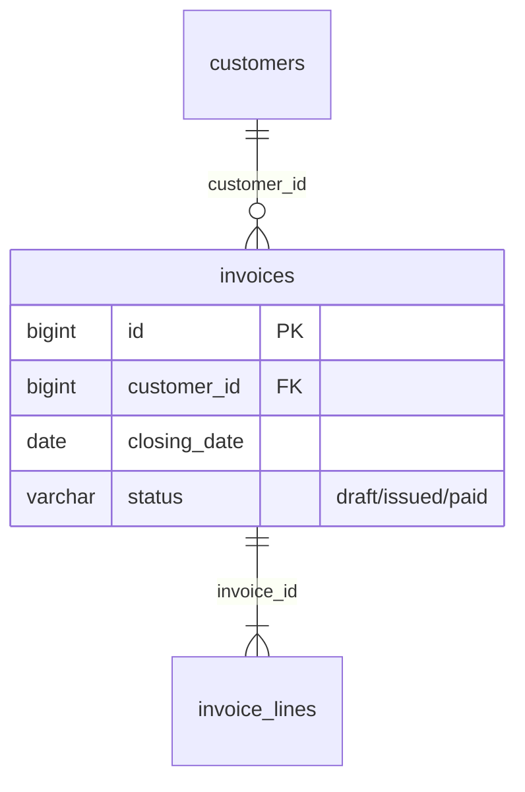
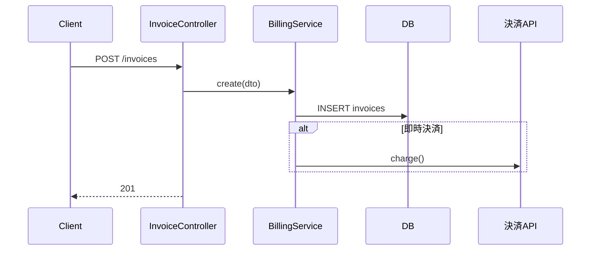
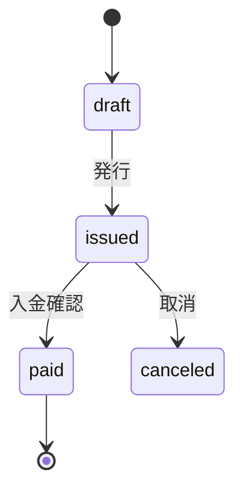

# Mermaid 図の描き方

仕様書に載せる図の種類、作り方、守るべきルール。

## 共通ルール

1. **図も根拠付き**: 図の直後に「根拠」表を置き、ノード・矢印・遷移ごとに `file:line` を示す。根拠のない要素は描かない。
2. **推測は点線**: コードから確定できない関係は点線(`-.->`、`..>`)で描き、注記に「推測」と書く。
3. **1図に詰め込まない**: ノードが20を超えたら、サブシステムや機能単位で図を分ける。全体図は粗く、詳細図は細かく。
4. **IDは英数字、表示名は日本語可**: `billing["請求"]` のようにする。ID に `/`、`-`、`.`、空白を使わない。
5. **予約語に注意**: `end` はノードIDに使えない。ラベル内の `()[]{}` や `"` はダブルクォートで囲むか `#quot;` に置き換える。

## 図の種類と作り方

### モジュール依存図(flowchart) — 機械生成

```bash
python3 scripts/dep_graph.py <対象> --prefix src --depth 1            # 内部モジュールのみ
python3 scripts/dep_graph.py <対象> --prefix src --depth 1 --external # 外部ライブラリも
```

- 出力をそのまま `specs/diagrams/module-deps.md` に保存する。手で書き換えない(再生成できる状態を保つ)
- 赤線(相互依存)は設計上の注意点として `open-questions.md` にも記録する
- `--depth` はリポジトリ構造に合わせて調整する。ノードが多すぎれば浅く、粗すぎれば深くする
- DI、動的import、リフレクション、設定ファイル経由の依存は拾えない。読んで見つけた場合は点線で手書き追記した別図にする

### 画面遷移図(flowchart) — 機械生成(フロントエンド)

```bash
python3 scripts/screen_inventory.py <対象> --transitions
```

- 出力をそのまま `specs/diagrams/screen-transitions.md` に保存する。手で書き換えない
- 拾えるのはリテラルの遷移先だけ。変数で組み立てた遷移・名前付きルート・ミドルウェアのリダイレクトは、読んで見つけたものを点線で手書き追記した別図にする
- 「画面に対応しない遷移先」の表は、外部リンク・API・未検出のルートが混ざる。未検出のルートなら画面一覧の漏れなので Step 3 に戻る
- 画面が20を超えたら、機能(URL の第1階層など)ごとに分けて描く

### ER図(erDiagram) — スキーマから作る

マイグレーション、ORMモデル、DDL を根拠にする。



- 外部キー制約がDBに無く、アプリ側でだけ関連している場合はその旨を注記する
- カラムは主要なものに絞る(PK、FK、状態、金額、日付)。全カラムは表で別に載せる

### シーケンス図(sequenceDiagram) — 主要な処理フロー

エントリポイントから外部連携・DB更新までを追った結果を描く。重要な機能(業務の根幹、外部連携を含むもの)に絞る。



- `alt` / `opt` / `loop` で分岐・繰り返しを表す。条件はコード上の条件式を要約して書く
- トランザクション境界は `rect` や `Note over` で示す

### 状態遷移図(stateDiagram-v2) — ステータスを持つエンティティ

`enum`、ステータス定数、遷移を行う箇所(`status = ...` の代入)を集めて描く。



- 遷移ごとに「どこで(file:line)」「どんな条件で」を根拠表に書く
- enum に定義があるのに遷移元・遷移先が見つからない状態は、未確認事項に積む

## 保存先

- 全体図: `specs/diagrams/`(`module-deps.md`、`screen-transitions.md`、`er.md` など)
- 機能ごとのシーケンス図・状態遷移図: 各モジュール仕様の該当節に埋め込む
