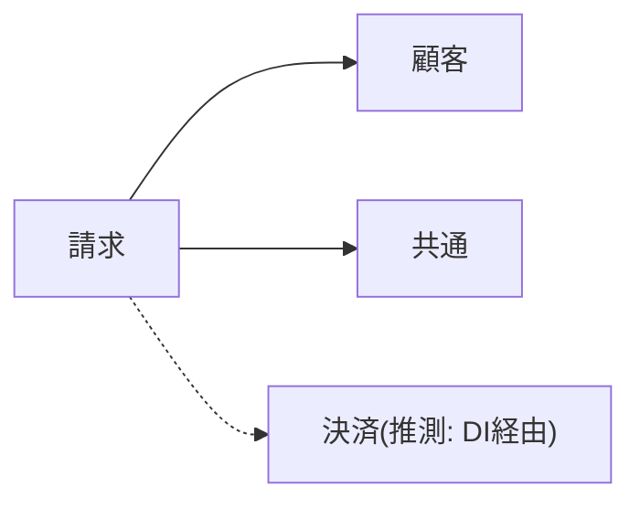
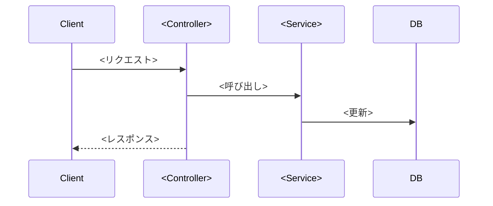

# <モジュール名> 仕様

- 抽出元コミット: `<hash>`
- 対象パス: `<path>`
- 言語/フレームワーク: <...>

## 概要

<このモジュールの役割を2〜3文で。推測を含む場合は「(推測)」と付ける>

## エントリポイント

| 種別 | 名前/パス | 概要 | 根拠 |
|---|---|---|---|
| HTTP | `POST /invoices` | 請求書を作成 | `src/invoice/controller.ts:42` |

## 依存関係

<dep_graph.py をこのモジュールに絞って(--prefix で)実行した図、または全体図の該当部分>



## 機能仕様

### <機能名>

**処理フロー**(主要機能のみ)



**入力**

| 項目 | 型 | 必須 | 制約 | 根拠 |
|---|---|---|---|---|

**処理**

1. <処理の流れ> (`file:line`)

**出力**

- レスポンス: <...>
- 更新データ: <テーブル.カラム>
- 発行イベント: <...>

**エラー**

| 条件 | 結果 | 根拠 |
|---|---|---|

**権限**

- <認可条件> (`file:line`)

## 業務ルール

| ID | ルール | 種別 | 根拠 |
|---|---|---|---|
| BR-001 | 締め日が月末の場合は翌月1日0時で確定 | 事実 | `src/billing/closing.go:118` |
| BR-002 | 端数は顧客保護のため切り捨てと思われる | 推測 | `src/billing/calc.go:30` |

## データモデル

```mermaid
erDiagram
  <table_a> ||--o{ <table_b> : "<fk>"
```

| テーブル/エンティティ | 主なカラム | 関連 | 根拠 |
|---|---|---|---|

## 状態遷移(ステータスを持つ場合)

```mermaid
stateDiagram-v2
  [*] --> <初期状態>
  <状態A> --> <状態B>: <契機>
```



| 遷移 | 条件 | 根拠 |
|---|---|---|

## 外部連携

| 相手 | 方式 | 用途 | 根拠 |
|---|---|---|---|

## 未確認事項

- [ ] <コードからは判断できなかった点、テストと実装の食い違いなど>
