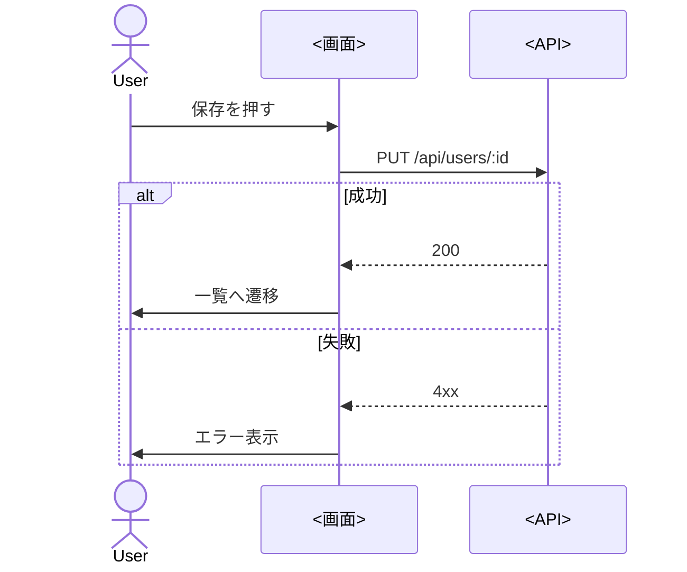

# <画面名> 画面仕様

- 抽出元コミット: `<hash>`
- ルート: `<例: /users/:id>`(定義: `<file:line>`)
- 画面ファイル: `<path>`
- レイアウト: `<layout のファイル>`
- 言語/フレームワーク: <...>

## 概要

<この画面でユーザーが何をするかを2〜3文で。推測を含む場合は「(推測)」と付ける>

## アクセス条件

| 条件 | 満たさない場合 | 根拠 |
|---|---|---|
| ログイン済み | `/login` へリダイレクト | `middleware.ts:12` |

## URL パラメータ・クエリ

| 名前 | 種別 | 用途 | 根拠 |
|---|---|---|---|
| `id` | パス | 表示するユーザーのID | `app/users/[id]/page.tsx:3` |
| `page` | クエリ | ページ番号(既定 1) | `...` |

## 表示項目

| 項目 | データの出どころ | 書式・加工 | 表示条件 | 根拠 |
|---|---|---|---|---|
| 氏名 | `GET /api/users/:id` の `name` | なし | 常に | `...` |
| 登録日 | 同 `createdAt` | `yyyy/MM/dd` | 常に | `...` |

## 状態

`screen_inventory.py --screen` の「状態分岐」と、`loading` / `error` / `not-found` 等の状態ファイルを根拠にする。コードに無い状態は書かず、必要そうなら未確認事項へ。

| 状態 | 条件 | 見えるもの | 根拠 |
|---|---|---|---|
| 読み込み中 | `isLoading` | スケルトン | `...` |
| 空 | `data.length === 0` | 「ユーザーがいません」 | `...` |
| エラー | `error` | エラーメッセージと再試行ボタン | `...` |
| 成功 | 上記以外 | 一覧 | `...` |

## 入力項目

| 項目 | 型・部品 | 必須 | 制約 | 初期値 | 根拠 |
|---|---|---|---|---|---|
| 氏名 | テキスト | ○ | 1〜50文字 | 現在値 | `schema.ts:5` |

## 操作

| 操作 | 実行条件 | 処理(ハンドラ → API) | 結果 | 根拠 |
|---|---|---|---|---|
| 保存 | フォームが有効 | `onSubmit` → `PUT /api/users/:id` | 成功: 一覧へ遷移 / 失敗: エラー表示 | `...` |

**処理フロー**(重要な操作のみ)

## 呼び出す API

| メソッド・パス | タイミング | 実行場所 | 根拠 |
|---|---|---|---|
| `GET /api/users/:id` | 表示時 | サーバ / ブラウザ | `...` |

## 遷移

| 契機 | 遷移先 | 条件 | 根拠 |
|---|---|---|---|
| 保存成功 | `/users` | なし | `...` |

## 業務ルール

| ID | ルール | 種別 | 根拠 |
|---|---|---|---|
| BR-001 | ステータスが承認済みのときだけ「取消」ボタンを表示 | 事実 | `...` |

## 未確認事項

- [ ] <コードからは判断できなかった点、スキーマと画面の制約の食い違いなど>
